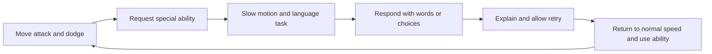
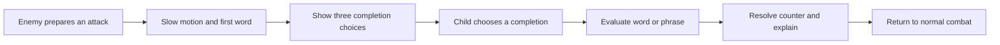
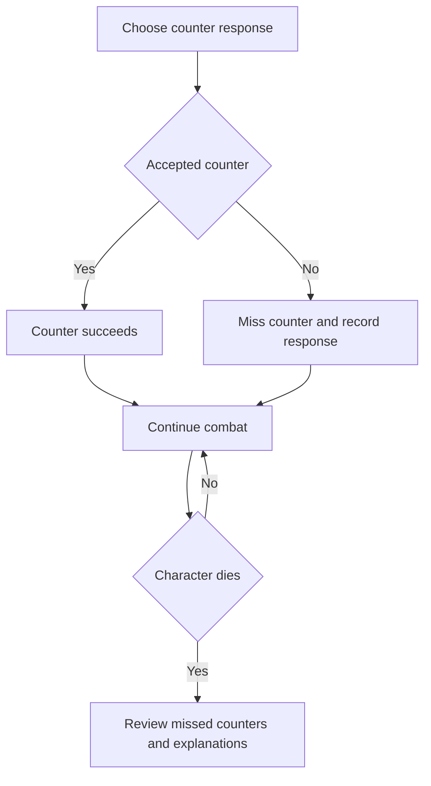
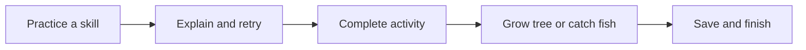
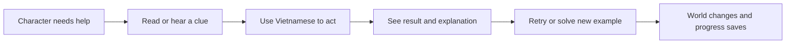

# Learning game ideas — discussion notebook

Status: brainstorming. These are candidate ideas, not approved features or an implementation plan. Update this file as we discuss, keeping decisions and rejected directions distinguishable.

## Confirmed context

- Native Vietnamese-speaking children studying school Tiếng Việt.
- First release: Grades 1-2 reading and spelling; longer-term vision covers Grades 1-5.
- Windows first, fully offline including setup and first use.
- Ordinary laptops with CPU and integrated graphics; dedicated GPU and AI are not required.
- Android and iOS are future possibilities.
- Level of parent involvement remains undecided.

## User's original ideas

- Add achievements or simple badges that make children want to return to learning.
- A planting game: let a tree grow as the child learns.
- A fishing game: completing an exercise could let the child catch a fish.
- Explore a game that naturally incorporates learning Vietnamese into play.
- Possibly offer several modes: ordinary learning with minigame rewards, naturally integrated learning games, and games using learning responses as player input.

The key question is how to make learning itself part of the fun, beyond attaching a prize to a worksheet.

## Three relationships between learning and play

These are useful design lenses; a real activity can combine them.

| Candidate | How it works | Example | Trade-off |
|---|---|---|---|
| Learning earns a reward | Finish meaningful practice, then see progress in a game world | Complete a lesson and water a tree or catch a fish | Simple to understand and build; game can feel detached from learning |
| Learning is the game action | Reading, spelling, or understanding changes the game directly | Read an order and choose the matching fish for a character | Stronger connection; requires careful content and interaction design |
| Learning supplies game input | Build words, choose sentences, or respond orally to control play | Arrange a sentence that tells a character what to do | Flexible and expressive; must avoid making typing or speech recognition the real challenge |

## Concept A — My growing garden

**User seed:** learning helps a tree grow.

**Possible reward version:** a completed learning activity earns water; completed lessons contribute to visible tree growth. Growth stays saved locally between sessions.

**Possible integrated version:** read a character's request, match a plant label, assemble a word to label a seed packet, or order instructions for caring for a plant. Correct understanding helps the garden change visibly.

**Questions to explore:** one special tree or a small garden? Predictable growth or collectible plants? How much interaction beyond learning is worthwhile?

**Design hypothesis:** persistent growth could support a calm daily routine. Validate whether children enjoy it rather than assuming it will motivate them.

## Concept B — My fishing pond

**User seed:** completing an exercise lets the child catch a fish.

**Possible reward version:** completing a practice set gives a fishing turn, followed by a fish entry in a local collection.

**Possible integrated version:** hear or read a clue and select the matching word-fish; combine syllable tiles to complete a fish's name; understand a short request to choose which fish to help or catch. The language task must remain clear rather than becoming a reflex test.

**Questions to explore:** collection pond or fishing adventure? Choose a fish deliberately or discover one after completion? Is fishing a short celebration or the main lesson environment?

**Design hypothesis:** collecting different fish could encourage return visits. Content quality and learning progress must still be evaluated independently of collecting behavior.

## Concept C — A small Vietnamese story world

**Assistant proposal extending the user's integrated-game idea:** help characters solve everyday problems in a village, school, garden, or riverside setting.

Example activities:

- Read a sign to choose a destination.
- Match a written request to the correct object.
- Assemble a short sentence to send a useful message.
- Read a short story event and arrange what happened next.
- Choose a fitting reply in a familiar situation.

**Trade-off:** strongest opportunity for meaningful language use, but more story writing, illustration, and branching content than a reward layer. A small playable scene could test the concept before committing to a whole world.

## Concept D — Roguelite action adventure as repeatable challenge mode

**User seed:** a roguelike slash game as an endgame activity; potentially build the product in Unity. Interpretation pending: short repeatable action runs with changing encounters and upgrades. The exact combat style has not been confirmed.

**Scope status:** exploratory longer-term mode. Grades 1-2 reading and spelling remain the selected first-release direction. User has not yet chosen Unity or approved adding combat to the first release.

### Three ways learning can participate

| Candidate | Learning and play relationship | Trade-off |
|---|---|---|
| Paused encounter choices — recommended starting experiment | Brief combat sections alternate with safe decision moments; read a clue, assemble a word, or understand a sentence to choose a useful power or route | Protects reading time; must keep choices meaningful and avoid repetitive quiz interruptions |
| Language-powered action | Choose or assemble Vietnamese words to activate abilities, affect enemies, or solve encounter objectives | Strong learning connection; demanding to make language rules, game effects, and feedback understandable |
| Practice unlocks action runs | Complete practice, then play an action run with cosmetic rewards or unlocks | Easiest separation of systems; combat engagement does not itself establish Vietnamese learning |

Example of a contextual choice: a character asks for shelter from rain; understand the request and select the shield that creates shelter. Match the objective and available choices to reviewed learning content, rather than assuming fantasy upgrade names teach school Vietnamese.

### Proposed small experiment

One character, one short arena, a small enemy set, three language-linked choices, and one clear ending. Use simple 2D presentation and generous reading pauses. Test whether children understand the choices and can apply the target language skill in a fresh example outside the run. This is a proposed validation slice, not permission to implement.

Run difficulty and language difficulty need separate controls. A child who struggles with movement should still be able to practice the target skill. Language errors should produce explanation and another attempt; reflex failure must not be recorded as a literacy failure. Core progress and earned learning achievements persist when a run ends. Save/resume and a natural stopping point matter for short sessions.

Gentle fantasy presentation, combat intensity, and failure consequences require explicit discussion for the Grade 1-2 audience. Consider a non-combat adventure alternative if it better serves the children being tested.

### Unity direction

Unity is a credible candidate when animated characters, combat, encounters, and several game modes become central. Its official resources cover [2D tools](https://unity.com/features/2d) and [Windows, Android, and iOS player requirements](https://docs.unity3d.com/6000.0/Documentation/Manual/system-requirements.html). Platform support does not guarantee this product's performance on every integrated-graphics laptop; benchmark an agreed baseline.

Engine choice remains open. Compare whole-product Unity against a learning app with a separate game only after the gameplay direction is clearer. The latter introduces packaging and progress-sharing work; a Unity-centered product introduces engine/runtime overhead and game-specific UI work. For a genuinely game-centered product, a single Unity application is the current recommendation to investigate.

Development editor installation and build tooling are separate from the offline child-facing runtime requirement. Any eventual Unity build must still bundle content, avoid mandatory online services, and work without CUDA or a dedicated GPU. No Unity scaffold or new Unity-specific configuration is authorized by this notebook entry.

### Concept D discussion question

User selected a combination: manual attacks and dodges plus Vietnamese-controlled abilities. Exact pacing and language interaction remain open.

### Selected direction — manual combat plus language abilities

**Confirmed preference:** the child controls attacks and dodges; Vietnamese also participates in controlling abilities. This selects an idea to explore, not an implementation-ready design or engine decision.

**Selected interaction direction:** movement, basic attacks, and dodging remain immediately available. Vietnamese interactions occur both in safe preparation rooms and during combat. During combat questions, slow motion gives the child time to respond. Exact slowdown, timing, damage rules, and accessibility fallback remain open.

Candidate language mechanics:

| Mechanic | Example | Question to validate |
|---|---|---|
| Build an ability word | Combine syllable and tone tiles into a reviewed word that activates a shield | Does the child learn the spelling rather than memorize tile positions? |
| Understand a useful instruction | Read a short clue and choose the ability that solves the situation | Is comprehension necessary, or can the child guess from icons alone? |
| Assemble an action sentence | Arrange a short sentence that instructs a companion | Is sentence construction clear at the selected reading level? |

These are alternative mechanics to prototype, not three required systems. Start with one. Use new examples to check learning transfer beyond successful combat.

Example candidate loop:

Safe-room candidate: choose and prepare language-powered abilities before the next encounter. Combat candidate: a deliberate special-ability trigger opens a short question while the world slows. Whether questions are player-triggered or event-triggered remains undecided. Avoid frequent interruptions that make each attack a quiz. Keep language and reflex performance separate in progress records. Speech recognition must not be required for abilities.

### Selected pacing — preparation plus slow-motion questions

**User preference:** use both safe-room preparation and in-combat language interactions; combat questions use slow motion.

Proposed division to discuss:

- Safe rooms introduce or rehearse the target skill and let the child choose abilities.
- Combat questions apply familiar skills in fresh short examples, with replayable audio where useful.
- Answering activates an ability and returns action to normal speed; how incorrect answers and retries affect action remains undecided.
- Progress records distinguish learning responses, hints, and retries from combat success.

**Deferred by user:** do not resolve damage protection, reading deadlines, or exact slowdown tuning at this brainstorming stage. Keep slow motion as the chosen direction and revisit detailed behavior during prototype playtesting. No invulnerability, forced full pause, or timer rule has been selected.

Prototype observation should include reading/listening time, missed prompts, answer quality, and whether background combat distracts the child. Do not tune question timing solely around experienced adult players.

### Three ability-learning relationships — scope clarified

User wants all three relationships in the overall vision, with different priorities:

| Relationship | Current direction | Scope |
|---|---|---|
| Question powers a selected ability | A normal Vietnamese question supports casting or strengthening an ability; exact question types and effect remain to design | Current gameplay discussion |
| Language creates an ability | Build words or sentences that directly determine an ability or its effect | Future gameplay vision; deliberately deferred because of complexity |
| Language counters an encounter | Enemy action presents a first word; player chooses one of three completions to form a valid word or meaningful phrase and counter the action | Current gameplay discussion; concrete example supplied by user |

These priorities concern the proposed adventure mode. They do not automatically add a full roguelite to the approved first-release reading/spelling scope.

### Enemy word-counter mechanic

**User example:** an enemy attack displays “lá”. During slow motion, the UI offers three possible words; choosing “chắn” forms “lá chắn” and counters the attack.

Proposed interaction capture:

The child uses a language response as a defensive action, making the question part of the encounter. The final label for this mechanic is unselected.

Content design points to settle later:

- Validate complete expressions in context. A phrase can be meaningful without being a compound word; do not label every accepted answer as the same linguistic category.
- Define whether the task asks for any meaningful completion or the completion appropriate to the attack. For example, “lá cây” is meaningful too; it cannot be marked linguistically wrong merely because the intended counter is “lá chắn”.
- If exactly one response should succeed, make the instruction and context unambiguous, and have a teacher review all three options. Alternative meaningful responses need an explicit acceptance rule.
- Show or play the completed expression so children connect their choice to its meaning and the visible counter effect.
- Vary examples and choice positions so the activity tests language rather than memorized UI placement.
- Keep hints, incorrect language responses, and combat outcomes distinct in progress records.

Not yet selected: the other two words in the example, question frequency, whether all enemy types use this mechanic, and the precise counter effect. Slow-motion timing and protection remain deferred as requested.

### Selected failure and teaching flow

**User decision:** an incorrect answer misses the counter. Do not interrupt combat with an explanation or retry for that counter. Present the learning explanation after the player character dies.

A missed counter is not automatically instant death. Continue the encounter using combat rules still to be designed; exact damage and subsequent attacks are unselected. This decision currently applies to enemy word counters, not automatically to normal skill questions or non-combat lessons.

Keep a record of missed counter prompts and selected responses for the post-death review. Proposed review content: original prompt, child's selection, accepted completion, completed expression and its meaning, and why it fits the encounter. If an alternative is meaningful but contextually unsuitable, explain that distinction rather than calling it an invalid expression.

**User decision:** successful runs also include mistake review at the end. Review must suit children; exact presentation and interaction are deliberately deferred for a later discussion. This includes review length, grouping, tone, and optional follow-up practice. Behavior for voluntarily ended runs remains open. Combat death does not erase earned learning progress.

### Future vision — language-created abilities

Preserve the creative direction: constructing a word or sentence creates an ability or changes its behavior. Start eventual exploration with a small reviewed vocabulary and predictable authored effects before considering an open-ended language system. No generative AI or speech model is required by this idea. Defer grammar composition rules, balancing, and implementation until the simpler mechanics have been explored.

**Deferred discussion:** design child-friendly post-run review for both character death and successful completion. Do not select grouping, review length, mandatory steps, or follow-up practice yet.

## Candidate mode overview

| Mode | Child's purpose | Possible shared learning content |
|---|---|---|
| Guided practice | Follow a short, clear learning sequence | Reviewed skill exercises and explanations |
| Play and learn | Solve language tasks inside a garden, pond, or story scene | The same skill objectives with a contextual presentation |
| My collection | Revisit trees, fish, and earned achievements | Saved progress and optional word or story recall |
| Repeatable adventure | Explore optional roguelite runs after foundational learning | Reviewed language choices, contextual puzzles, and separately tracked game progress |

Recommendation for discussion: test one theme and one learning loop first. Keep other modes in the vision until we know what children find useful and enjoyable. Several modes should not require separate, inconsistent curricula.

## Example loops to compare

Reward-focused candidate:

Integrated candidate:

## Achievement and feedback candidates

These labels and thresholds need discussion; none are final.

- Skill milestones: apply a spelling pattern correctly in fresh examples.
- Reading milestones: finish and understand a short story.
- Exploration milestones: encounter several reviewed topics or stories.
- Effort recognition: return to a difficult activity and use feedback.
- Collection milestones: a tree reaches a growth stage or a pond gains another fish.

Track effort, completion, and demonstrated skill separately. A badge for finishing a lesson must not imply the child has mastered its skill. Repeating a familiar easy item should not establish mastery.

Proposed tone: encourage trying again; no tree death, lost fish, or punishment for missed days. Keep collection progress available offline. Offer a clear stopping point after a short session.

## Practical boundaries to carry into design

- No online leaderboard, account, or live service required.
- Game artwork and audio ship with the installer.
- Core game actions work through choices, matching, and assembling; microphone and model recognition are optional experiments.
- Avoid tight timers and precise mouse gestures in early reading activities unless that challenge is intentionally being tested.
- Keep instructions audible and replayable; use clear Vietnamese text with complete diacritics.
- Language difficulty, input difficulty, and game difficulty should be distinguishable during playtesting.
- Record whether children understand the language, rather than measuring only speed, rewards earned, or session length.

## Discussion log

### 2026-10-22 — Initial capture

Confirmed: user wants to explore achievements, tree growth, fishing, and naturally integrated Vietnamese learning, potentially through multiple modes. No theme, economy, badge thresholds, or minigame has been selected.

First question for discussion: should our first experiment emphasize a game world driven by Vietnamese tasks, or short exercises that earn garden/fishing rewards?

### 2026-10-22 — Roguelite and Unity exploration

User proposed a roguelike slash endgame mode and raised Unity as a possible engine. Added Concept D with three integration approaches. Current recommendation: investigate short runs with safe language decision moments; confirm action style before designing encounters. Earlier garden, fishing, and story ideas remain open candidates.

User then selected manual attacks/dodges combined with Vietnamese-controlled abilities. Updated Concept D with the selected combination and proposed pacing alternatives. No Unity project, combat implementation, or final gameplay design has been approved.

User selected both safe-room preparation and in-combat interactions, with slow motion for combat questions. Recorded this preference; damage protection, question deadlines, trigger conditions, and wrong-answer consequences remain unapproved.

User asked to defer concerns about question-time combat pressure. Keep slow motion; leave protection and timing tuning for a later prototype discussion. Continue exploring the connection between language answers and ability effects.

User wants all three learning/ability relationships. Focus current exploration on normal questions powering abilities and enemy-triggered word counters. Their counter example is “lá” plus a selection from three words, with “chắn” forming “lá chắn”. Keep language-created abilities as a future gameplay vision because of their greater complexity.

User selected missed counter on an incorrect response, with explanations after character death. Added a post-death review flow; missed counter does not imply automatic instant death. Review behavior for successful or voluntarily ended runs remains open.

User confirmed successful runs must also show mistake review, presented thoughtfully for children. Detailed review UX is explicitly deferred. Earlier log entries describe discussion history; the current decision is review after both death and successful completion.

## Related files

- [Product vision](2026-10-22-vietnamese-app-vision.md)
- [Market and exercise research](2026-10-22-vietnamese-learning-market-research.md)
- [Discovery record](2026-10-22-vietnamese-app-discovery.md)
