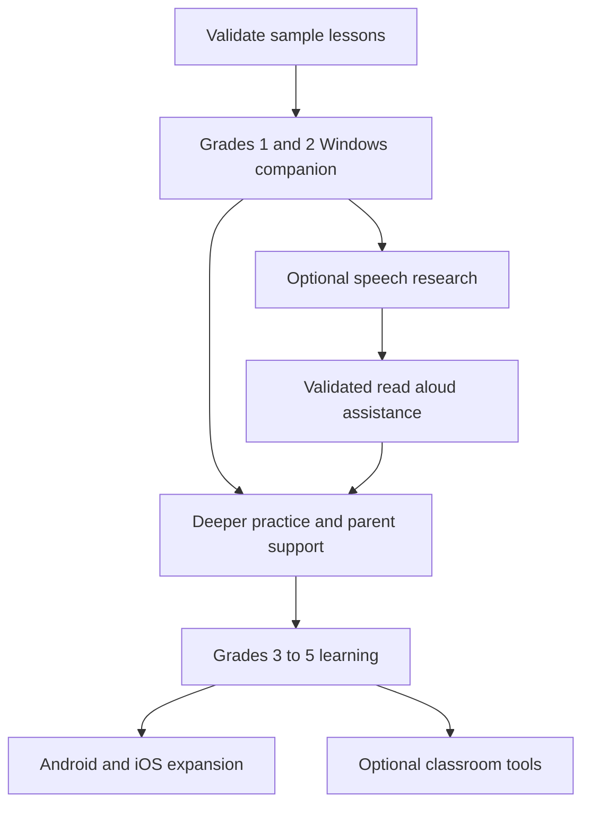
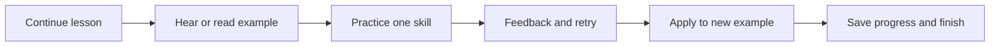

# LearningVietnamese product vision

Date: 2026-10-22.

Status: user selected Grades 1-2 reading and spelling as the first-release direction, confirmed fully offline operation first, and confirmed support for ordinary Windows laptops without a dedicated GPU. Other features, phase boundaries, and release gates below are proposed for review. This is a product roadmap, not an implementation plan or a commitment to deliver every feature.

## Purpose and audience

Help native Vietnamese-speaking children in Grades 1-5 develop school Tiếng Việt skills through approachable, meaningful practice. Begin with a Windows app for Grades 1-2; preserve a path to Android and iOS.

User selected Unity 6.6. Exact editor patch and UI architecture remain to be agreed; [UI direction notebook](2026-10-22-unity-ui-direction.md) records the proposed UI Toolkit evaluation.

Children are the primary learners. Parents support routines and review progress. Teachers may review curriculum and content initially; classroom management is a later opportunity.

Success means improved reading, spelling, comprehension, and independent practice. Time spent, points, and streaks are supporting signals, not evidence of mastery.

## Product principles

- Teach a clear skill, let the child apply it, explain mistakes, and revisit it in a new context.
- Use original or appropriately licensed stories, illustrations, and recordings with teacher-reviewed answers and explanations.
- Align learning objectives with verified school competencies; map textbook lessons separately when editions and rights are confirmed.
- Match presentation and input demands to reading ability. Grade 1 should not require fluent reading or Vietnamese keyboard proficiency to start.
- Let children hear instructions again, retry without shame, and finish at a natural stopping point.
- Keep core learning usable without AI inference. A model failure must not block a lesson.
- Core learning must run on ordinary Windows laptops using CPU and integrated graphics, with no dedicated GPU or CUDA requirement. Exact RAM, CPU, storage, and Windows version floors will be selected and measured during technical design.
- First release works fully offline from installation and first launch. Bundle required runtime dependencies, fonts, lessons, illustrations, and audio; require no account, activation server, content download, or online service.
- Support mouse and keyboard first while designing interactions that can also work with touch.

## Phased roadmap

Phases have readiness gates rather than dates. Speech research can proceed alongside core learning; its outcome does not block the first release.

| Phase | Proposed functions | Readiness gate |
|---|---|---|
| 0 — Learning prototype | A small original Grade 1 lesson and Grade 2 lesson; sample audio; representative exercises; draft child navigation | Teacher confirms objective and answer quality; family pilot identifies instruction and interaction problems |
| 1 — First release | Grade 1-2 reading and spelling, guided lesson sequence, story reading/listening, objective exercises, explanations, local progress, simple parent view | Reviewed content pack; reliable Windows playback and saving; children can complete sampled activities with recorded assistance needs |
| 2 — Stronger companion | Targeted review, placement suggestions, richer vocabulary and sentence tasks, multiple local learner profiles, parent summaries, printable follow-up | Recommendations are explainable; progress distinguishes independent success from hints; families find reports actionable |
| 3 — Upper-primary learning | Grade 3 bridge, then Grades 4-5 comprehension, vocabulary/grammar, retelling, guided paragraph and composition work | Grade-specific teacher review; open responses have rubrics and appropriate adult review; UI suits older pupils |
| 4 — Platform expansion | Android and iOS layouts, touch controls, audio/microphone support, mobile packaging; optional cross-device progress | Content/runtime portability demonstrated; device performance and mobile usability evaluated; sync policy agreed if introduced |
| Optional classroom track | Teacher assignments, class progress, differentiated practice, content authoring workflow | Classroom need validated; roles, access, and content review ownership defined |

## First-release feature proposal

| Area | Proposed behavior | Boundary |
|---|---|---|
| Child home | Continue current lesson, choose practice, open story library | Small set of clear actions |
| Grade and learning path | Adult chooses Grade 1 or 2; child follows reviewed sequence | No claim of complete two-year curriculum until coverage is audited |
| Reading foundation | Letters, sounds, rhymes, tones, familiar words and short sentences | Follow reviewed Vietnamese teaching conventions |
| Story activity | Short illustrated passage, model audio, simple comprehension prompts | Audio available on demand; narration quality reviewed |
| Spelling practice | Choose letters or syllables, complete words, distinguish reviewed spelling patterns | Preserve diacritics when they are the learning objective |
| Exercise formats | Single choice, picture-word matching, syllable/word assembly, gap-fill, sentence ordering | Click/tap alternatives for dragging; typing optional for early tasks |
| Feedback | Explain correct response, replay model, retry, then apply skill to another example | Avoid awarding mastery for repeated guessing |
| Progress | Save lesson position and performance by skill locally; show simple parent summary | No account, cloud sync, or remote dependency in first release |
| Accessibility | Readable Vietnamese diacritics, replayable prompts, visible audio states, usable focus and keyboard actions | Validate with target-age children on intended Windows devices |

Proposed lesson flow:

Target session length is initially 10-15 minutes, to be tested rather than enforced. Audio or recording permissions must never be required for non-recording exercises.

## Confirmed offline requirements

- Deliver a self-contained Windows installation package that can be transferred by USB or other offline means. Obtaining the installer on another device does not create an app runtime network requirement.
- Installation, onboarding, lessons, audio playback, feedback, parent summaries, and saving/resuming progress work with networking disabled on a clean supported Windows machine.
- Bundle all required dependencies and assets. Do not fetch fonts, browser runtimes, packages, model weights, or license activation during setup or first use.
- Store progress on the device. Design local export/import for backup during technical planning; cross-device cloud sync remains a future optional feature.
- Use bundled reviewed audio for core lessons. Any optional local model must ship with its required files and run without online calls; otherwise keep it in a separate research build.
- Future content expansion can use versioned offline import packs or replacement installers. Never make an update check mandatory for learning.
- No required analytics or telemetry connection. Missing internet must not produce repeated error banners or interrupt practice.

Offline scope applies to every shipped Phase 1 lesson, not a promise that the first content pack covers the complete Grade 1-2 curriculum. Installer size, supported Windows versions, and minimum hardware remain design decisions.

## Future function inventory

| Function | Intended learning value | Dependencies or limits |
|---|---|---|
| Read aloud recording and replay | Help children hear and reflect on their reading | Microphone controls, playback, explicit retention choice |
| Assisted reading feedback | Suggest words or segments worth revisiting | Validated child-speech recognition; uncertainty shown; regional accents evaluated |
| Pronunciation assistance | Coach a specific sound or tone | Separate assessment research; transcript matching is insufficient |
| Listening comprehension | Understand spoken instructions and stories | Reviewed audio, comprehension questions, replay rules |
| Dictation | Connect listening with spelling | Suitable text input or paper follow-up; distinguish keyboard skill from spelling |
| Vocabulary and grammar | Apply word meanings, word roles, punctuation, and sentence patterns | Grade-specific content and contextual explanations |
| Retelling and oral expression | Order events and explain ideas in own words | Recording optional; rubric and adult review where automatic judgment is unreliable |
| Guided writing | Plan, draft, review, and revise sentences, paragraphs, and compositions | Developmentally suitable prompts; rubrics; feedback should support the child's own work |
| Handwriting support | Practice letter formation and written fluency | Printable activities first; stylus evaluation is separate from mouse tracing |
| Personal review schedule | Revisit skills that remain difficult | Enough practice history; simple transparent rules before complex adaptation |
| Rewards and collections | Celebrate effort and progress | Optional personal goals; public rankings and competitive timers deferred |
| Parent dashboard | Suggest a useful next practice step | Skill-level evidence; understandable summaries, not only scores |
| Teacher workspace | Assign practice and identify shared class difficulties | Separate product discovery and access design |
| Additional offline content packs | Expand the bundled first-release lessons without requiring internet | Versioned local import, compatibility checks, storage and distribution size agreed during technical design |
| Cross-device progress | Continue between Windows and mobile | Accounts, synchronization, conflicts, and retention policy; separate decision from mobile support |
| Content authoring and review | Sustain accurate lessons across five grades | Objective tags, answer/explanation validation, provenance, versioning, reviewer responsibility |

## Gameplay vision under discussion

The [learning game notebook](2026-10-22-learning-game-ideas.md) explores a repeatable roguelite action mode with manual attacks/dodges, safe-room preparation, and slow-motion Vietnamese interactions during combat. Unity 6.6 is selected; gameplay implementation remains future work. Latest user priority is UI validation and basic app/exercise infrastructure before gameplay or a final roadmap. See [exercise and AI-content discussion](2026-10-22-exercises-and-ai-content.md).

Current exploration prioritizes normal questions that power abilities and enemy-triggered word/phrase completion counters. User example: enemy presents “lá”; child chooses “chắn” from three options, forming “lá chắn” to counter. Content must distinguish meaningful language from contextually useful combat choices.

For enemy word counters, user selected failure without an immediate teaching interruption: incorrect response misses the counter and combat continues. Preserve missed responses for review after character death or successful run completion. Review must be child-friendly; its detailed presentation is explicitly deferred. Missed counter does not automatically mean instant death; damage rules and review behavior for voluntarily ended runs remain undecided.

Longer-term gameplay vision: constructing words or sentences directly creates abilities. User explicitly deferred this more complex mechanic. Damage protection and exact slow-motion timing are also deferred, without selecting a default rule.

## Local model research relationship

Keep `G:\Projects\AIModel\Translate` as research input. Its CUDA STT and Windows-specific TTS playback are not yet app-ready cross-platform components. Evaluate recognition quality, latency, hardware, offline model size, and distribution terms before adopting them.

The current CUDA-only speech recognizer cannot be a core app dependency. Optional speech assistance needs a separately evaluated CPU-capable path or remains outside the baseline release. Bundled lesson audio and objective exercises must remain fully functional without any speech model.

First experiment: known short passages with recording/replay, followed by recognition evaluation on consented child samples. Separate recognition failures from learner errors. General-purpose conversation, automated essay grading, and definitive pronunciation scores are outside the first release.

## Release evidence

Before calling Phase 1 ready, review sampled and packaged content for accuracy, diacritics, audio quality, answer alternatives, and age suitability. Verify navigation, pause/resume, audio failure handling, interrupted sessions, and saved progress on the target Windows device profile.

Run installation and first launch on a clean supported Windows machine with networking disabled and no pre-cached app dependencies. Complete representative packaged lessons, play audio, save progress, restart, and resume. Verify required resources are present and routine learning attempts no outbound service requests.

Run these core release checks on an agreed baseline laptop with integrated graphics and no CUDA runtime or dedicated GPU. Measure startup, lesson transitions, audio playback, memory, and storage before setting numerical performance acceptance thresholds.

A small teacher/family pilot should record independent task completion, misunderstood prompts, hint usage, repeated error patterns, and performance on fresh examples before and after practice. Select sample size and release thresholds before that pilot; do not claim educational effectiveness from app engagement alone.

## Decisions for the next design discussion

1. Which exact Grade 1-2 competencies and first content pack will be teacher-reviewed?
2. How much parent help should the app assume during onboarding and ordinary lessons?
3. Should the speech pilot be bundled as experimental or remain a separate research build?
4. What are the content creation budget, ownership, and review responsibilities?
5. Which specific Windows versions and CPU, RAM, and storage floors should define the test laptop profile?

These decisions belong to the next design stage; they are not hidden implementation defaults.

## Related records

- [Discovery and confirmed scope](2026-10-22-vietnamese-app-discovery.md)
- [Market, exercise, and UI research](2026-10-22-vietnamese-learning-market-research.md)
- [UI resource acquisition status](../../../references/README.md)
