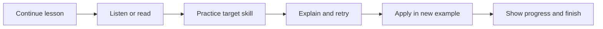

# Vietnamese primary learning market research

Research date: 2026-10-22. Audience: native Vietnamese-speaking pupils studying school Tiếng Việt, Grades 1-5. Windows first; Android/iOS possible later.

## Evidence and limits

Desk research of official product pages, public lesson previews, help articles, and competition instructions. No paid account, app installation, classroom observation, or child usability test. UI observations concern public navigation and documented interactions; they are not a pixel-level audit of current signed-in apps. Marketing effectiveness claims were not independently verified. This document proposes directions; it is not an approved product spec.

## Competitor comparison

| Product | Observed content and organization | Interaction or UI lesson for us |
|---|---|---|
| VMonkey | Separate reading, listening, phonics, and learning materials; grade/age levels; phonics combines story, games, printable follow-up | Keep an identifiable activity mode; connect target sounds to meaningful stories |
| VioEdu | Grade 1-5 Vietnamese; video instruction, practice, revision, assessment; personalized recommendations advertised | Provide an obvious next task and progress by skill |
| Trạng Nguyên | Vietnamese practice and competition; multiple response formats; cultural competition framing | Reuse varied question mechanics while keeping competition optional |
| OLM | Grade/topic/week navigation; instruction and practice; public previews include audio and image tasks | Make school-topic lookup available alongside a simple child home screen |
| Hoc10 | Public Grade 1 shelf filters by subject and distinguishes student books, workbooks, teacher books, and volumes | Keep grade and material type explicit; separate parent/teacher resources |
| HOCMAI | Teacher-led course catalog; Grade 1 Vietnamese course lists lessons and question practice | Pair explanation with active practice; avoid making video viewing the sole activity |

Sources: [VMonkey learning guide](https://monkey.edu.vn/tin-tuc/huong-dan-cach-hoc-vmonkey), [VioEdu subject introduction](https://tintuc.vio.edu.vn/vioedu-chinh-thuc-ra-mat-mon-tieng-viet-toan-tieng-anh/), [Trạng Nguyên exercise guide](https://tn-cdn.trangnguyen.edu.vn/tin-tuc/noi-dung-on-tap-ki-thi-hoi-cap-tinh-san-choi-trang-nguyen-tieng-viet-2526), [OLM Grade 1](https://olm.vn/bg/tieng-viet-1), [Hoc10 shelf](https://www.hoc10.vn/tu-sach/tieng-viet/lop-1/), [HOCMAI catalog](https://hocmai.edu.vn/).

VioEdu's current competition design uses weekly tasks, ranks, rewards, streaks, and timed matches. This is evidence of engagement mechanics, not proof of learning gains. Its 2026-27 rules also distinguish participation allowances for paid and unpaid accounts. [Official competition rules](https://tintuc.vio.edu.vn/dttq-26-27/).

Trạng Nguyên describes separate learn, practice, compete, and play modes, interactive videos, daily learning reports, and parent-awarded badges. These demonstrate a parent-facing progress layer alongside child activities. [Official homepage](https://trangnguyen.edu.vn/).

## Concrete exercise evidence

OLM's public sound-y preview includes selecting a reading, listening and assembling syllables, matching syllables with readings, audio gap-fill, picture identification, word-image matching, and questions about a short text. Its page also exposes practice, submit, explanation, continue, and repeat controls. Some access is VIP-restricted; behavior beyond the preview was not tested. [Public exercise preview](https://olm.vn/chu-de/tieng-tu-chua-am-y-342407).

Trạng Nguyên lists six formats: multiple choice, fill-in, matching, ordering, category drag-and-drop, and combined fill/select. Its February 2026 event instructions allow unaccented typing for Grades 1-2; this is a competition-specific input accommodation, not a general spelling standard. Its Grade 1 topics include phonics, easily confused spellings, vocabulary, pictures, sentence building, and reading comprehension. [Official exercise and topic guide](https://tn-cdn.trangnguyen.edu.vn/tin-tuc/noi-dung-on-tap-ki-thi-hoi-cap-tinh-san-choi-trang-nguyen-tieng-viet-2526).

## Proposed exercise library

The following are our design proposals and original illustrative examples, not copied competitor questions or a validated grade-by-grade curriculum.

| Skill | Example interaction | Initial placement to validate with teacher |
|---|---|---|
| Sound and letter recognition | Hear a sound, choose corresponding letter or picture | Grade 1 |
| Syllables and tones | Assemble onset, rhyme, and tone; play resulting syllable | Grades 1-2 |
| Spelling | Complete a familiar word using c/k or ng/ngh choices | Grades 1-3 |
| Vocabulary | Match word to picture, then use in short sentence | Grades 1-3 |
| Sentence structure | Arrange “Em / tưới / cây.”; explain punctuation | Grades 1-3 |
| Reading comprehension | Read a passage; answer who, why, and evidence questions | Grades 1-5, progressively harder |
| Vocabulary and grammar | Group words by meaning or role; revise sentence | Grades 2-5 |
| Listening and retelling | Listen, order story events, record retelling | Grades 1-5, progressively harder |
| Guided writing | Plan, draft, and revise paragraph with rubric | Grades 3-5 |
| Reading aloud | Listen to model, record, replay, receive cautious feedback | Pilot first; age and accent evaluation required |

Typing and handwriting are different skills. Mouse tracing cannot establish handwriting mastery. Offer printable or adult-reviewed writing tasks if needed. For younger pupils, word tiles and choices avoid testing keyboard skill when the target is comprehension. Preserve Vietnamese tones when spelling is the objective.

## Content progression

Use provisional bands: Grade 1 foundations; Grade 2 reading and sentence fluency; Grade 3 connected passages and short paragraphs; Grades 4-5 inference, vocabulary relationships, discussion, planning and revision. Validate exact competencies against current curriculum and teaching practice before labeling content school-aligned.

OLM's Grade 5 catalog visibly combines reading, vocabulary/sentence work, composition, and speaking/listening. This supports broadening beyond early phonics as pupils advance. [Grade 5 catalog](https://olm.vn/bg/tieng-viet-5).

Official teaching guidance emphasizes practice, application, and reading, writing, speaking, listening, rather than mechanical memorization. That supports including open responses and transfer tasks alongside automatically scored questions. This research did not verify all current curriculum amendments or textbook-adoption policy. [Government teaching guidance](https://xaydungchinhsach.chinhphu.vn/huong-dan-doi-moi-phuong-phap-day-hoc-va-kiem-tra-mon-ngu-van-119220723081034079.htm).

## Proposed child experience

Use Vietnamese instructions, replayable audio, one primary task per screen, readable diacritics, clear recording states, and click/tap alternatives to dragging. Grades 1-2 can use more illustration and spoken prompts; Grades 3-5 need longer text and a less preschool-like presentation. These are hypotheses to validate with children.

Proposed 10-15 minute session, with duration to test:

Home: continue lesson, choose practice skill, story library. Parent area: completed skills, recurring difficulties, recordings if retained, and suggested next practice. Use positive completion feedback; trial personal progress before adding public rankings or time pressure.

## Speech opportunity and limits

The inspected Translate prototype offers transcription and synthesis, not validated pronunciation assessment. Potential differentiator: private local read-aloud practice linked to lessons and comprehension. This is a hypothesis, not a verified market gap; desk research cannot establish competitors lack similar features.

First speech experiment should record and replay a known passage, assess recognition reliability on consented child samples across accents and devices, and distinguish recognition uncertainty from learner mistakes. Do not display an authoritative pronunciation score based only on transcript matching. Use reviewed recordings for instructional sound examples if synthesis quality is inadequate.

## Commercial observations

At research time VMonkey's public page displayed promotional prices of 599,000 VND for one year and 899,000 VND for lifetime access. These are page observations, not checkout-confirmed quotes; promotions and terms may change. [Product and price page](https://monkey.edu.vn/san-pham/vmonkey).

Other observations: OLM restricts some practice to VIP; VioEdu combines trial/evaluation with paid courses and differentiated competition allowances; HOCMAI sells teacher-led courses. Exact current prices for those products were not verified. Do not infer willingness to pay from competitor pricing alone.

## Three possible first releases

1. **Recommended: Grades 1-2 reading and spelling companion.** Short story, audio model, a small set of reusable exercise formats, retry explanations, parent progress; optional speech pilot. Narrower curriculum and content production scope. Grades 3-5 follow through richer tasks.
2. **Grades 1-5 practice workbook.** Broader audience; start with objective questions and skill filters. Larger authoring and review burden; limited support for writing and oral ability unless separately designed.
3. **Reading-aloud coach.** Closest to local model research, but speech reliability becomes central product risk. Narrower coverage of the school subject.

Before implementation, choose first learner band and primary learning outcome, then agree content ownership/review, offline requirements, typical hardware, and adult involvement. Teacher review and a small family pilot should test learning usefulness and usability before large-scale content production.
