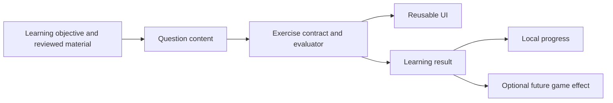

# Learning app discovery, UI validation and AI content

Derived from the 2026-10-22 discovery session. Project-owned experience, not a new global skill or upstream shared rule.

## Start from the latest scope

1. Read the memory hub and relevant linked note before reconstructing history.
2. Separate confirmed decisions, assistant recommendations, experiments and deferred ideas.
3. Treat user corrections as steering. Here, UI feasibility and exercise infrastructure precede gameplay; roadmap thinking is paused for later discussion, not replaced by an implementation request.
4. Ask one material question at a time during brainstorming. Do not repeatedly reopen explicitly deferred topics.
5. Present design before implementation. Selecting an engine or an idea does not approve a scaffold, package install, combat system, or final architecture.

## Prepare shared configuration selectively

Inspect upstream README, manifest, sync script and generated behavior before importing. Do not copy game architecture examples or fabricate assembly/version tokens for an empty project. Use the project filtered pull entry point and review preview before writes. Preserve local records and root text outside generated registries. Audit index/links and verify a zero-change preview afterward. Engine selection later does not itself justify importing monetization, cloud or unrelated package guidance.

## Research with evidence boundaries

Prefer official product/help pages and actual public exercise previews. Distinguish marketed features from observed interaction, education claims from measured outcomes, and source review from runtime verification. Record dated prices and access limitations. Keep a linked research artifact so future decisions do not rely on remembered product claims. A missing feature in public material is not proof of a market gap.

When inspecting an existing project, read its instructions and memory index, then use source to verify specific facts. Scope searches to owned assets and relevant packages. Avoid generated caches/logs except for an explicit evidence need. Do not migrate a reference project's entire dependency tree or assume its old engine version matches the new project's APIs.

## Prove AI-editable UI with rendered evidence

Evaluate a small representative app slice before broad infrastructure:

- Library cards and scrolling; question screen; basic feedback/audio controls.
- Vietnamese diacritics, long text, and input composition if typing is required.
- Small reusable controls and shared design values; avoid per-question bespoke screens.
- A concrete edit task: change shared style, add a data item, and resize layouts.
- Verify screenshots and actual focus, navigation, input and scrolling behavior.
- Test bundled resources offline on agreed integrated-graphics hardware.

UXML/USS can improve text-based editing, but syntax validity does not prove beauty. Web references provide visual direction, not drop-in React components for Unity. Use uGUI only where its concrete benefits justify another UI path. Keep acceptance criteria specific before claiming the UI workflow is validated.

## Separate learning content from presentation and gameplay

Define response formats, accepted alternatives, explanations, media references, stable IDs, versions and review status before mass content generation. Evaluate language knowledge separately from typing, motor performance, game survival and hints. A meaningful phrase can be contextually unsuitable without being linguistically invalid.

## Keep AI roles distinct

Development-time AI drafting, constrained template variation, and runtime local inference are separate choices. Reviewed bundled content is the recommended first path, not an approved final pipeline. Validate schema and consistency, then obtain educational review. A model validating its own answer is not independent evidence of correctness.

Fully offline means clean-machine install and first use also work offline. Include dependencies, fonts, assets and any required models. Runtime cloud inference conflicts with this requirement. CPU-only baseline excludes a required CUDA recognizer. Transcription is not validated pronunciation scoring; measure child speech before making claims.

## Preserve deferred gameplay accurately

Record user mechanics literally, with open consequences explicit. Current preferences: manual action, Vietnamese abilities, safe rooms and slow-motion questions, missed counters on wrong answers, post-run review after death or success. User deferred timing/protection and child-friendly review UX. Do not silently replace slow motion with full pause or add mandatory review behavior. Keep complex word-created abilities in future vision.

## End-session consolidation

Update the hub, detailed session record, relevant design notes and playbook lessons. Register each memory once in the canonical two-column index. Root adapters must point to it for Codex; Claude hook depends on the conventional index path and memory-first rule. Preserve source-owned Universal files unchanged.

Run the AI index checker and explicitly verify links beyond its built-in scope. Exercise hook behavior with dummy input after adding the index. Report exactly what is verified; documentation checks do not validate runtime UI, models, or educational quality. Do not claim a commit when workspace has no Git repository.
